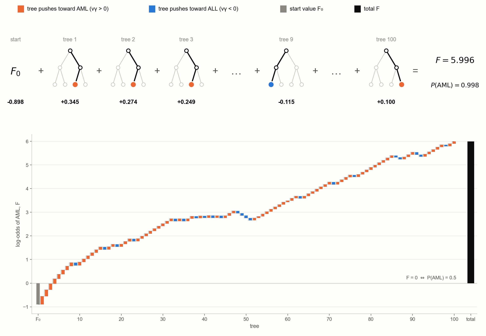

# gbt-demo

A demo of gradient boosted trees on the
[Golub et al. (1999)](https://doi.org/10.1126/science.286.5439.531) ALL/AML
leukemia gene-expression dataset (full reference under [Data](#data)).

## What is GBT?

Gradient boosted trees (GBT) make a prediction by adding up results from many small decision
trees. The trees are built one at a time in training. Each new tree is fitted to the errors
that the trees before it still make, and its output is scaled down by a learning
rate ν before it is added. No single tree is a good classifier on its own; the
sum is.

**Boosting** means combining many weak models, each only a little better than
guessing, into one strong model. The name comes from the original question in
machine-learning theory: can a weak learner's accuracy be *boosted* to any level
you want? Schapire showed that it can[^schapire]. The answer is to train the
models in sequence and have each one concentrate on what the earlier ones got
wrong. **Gradient** says how "got wrong" is measured. Each tree is fitted to the
gradient of the loss, the direction that most reduces the error. For this
classifier that gradient is simply the residual $y - p$, so each tree learns
what is left over. **Trees** says what the weak models are: small decision trees.

[^schapire]: Schapire RE, "The Strength of Weak Learnability", *Machine
    Learning* 5(2):197–227 (1990).
    doi:[10.1007/BF00116037](https://doi.org/10.1007/BF00116037).

Here the task is binary: is a leukemia sample ALL or AML? Each sample is one
patient's expression profile, and each of the 7,071 probe sets is a feature. The
model works in log-odds of AML, F:

1. **Start** every sample at the log-odds of AML in the training set,
   $F_0 = \ln(11/27) = -0.898$, which is $P(\mathrm{AML}) = 0.29$.
2. **Fit a tree** to the residuals $y - p$, where $y$ is 1 for AML and 0 for
   ALL, and $p$ is each training sample's current predicted probability. Each
   leaf outputs one value,
   $\gamma = \sum (y - p) \big/ \sum p(1 - p)$, summed over the samples in that leaf.
3. **Add the tree**, scaled down: $F_m(x) = F_{m-1}(x) + \nu\,\gamma_m(x)$.
4. **Repeat** for M trees, then convert to a probability:
   $P(\mathrm{AML} \mid x) = 1 / (1 + e^{-F_M(x)})$.

The demo uses scikit-learn's
[`GradientBoostingClassifier`](https://scikit-learn.org/stable/modules/generated/sklearn.ensemble.GradientBoostingClassifier.html);
the scikit-learn user guide covers the method in
[Gradient boosting](https://scikit-learn.org/stable/modules/ensemble.html#gradient-boosting).
For larger datasets, scikit-learn's `HistGradientBoostingClassifier`,
[XGBoost](https://xgboost.readthedocs.io/) and
[LightGBM](https://lightgbm.readthedocs.io/) do the same thing much faster.

### Training: how the first tree is built


Tree 1 of 100, fitted to the 38 training samples (27 ALL, 11 AML). Each box
shows how the training samples divide at that split. Each leaf shows the value γ
the tree outputs for any sample that lands there, and the step νγ it adds to the
log-odds of AML.

### Prediction with one tree


Test sample 51 (AML), which the model never saw in training, dropped through the
same tree. At each split the tree checks one gene, and the sample lands in a leaf
that adds 0.345 to its log-odds of AML. One tree only moves it from P = 0.29 to
P = 0.37.

### Prediction with the whole ensemble



The real prediction runs the sample through all 100 trees and adds up their
outputs. Top: the sum written out, each tree drawn with the sample's path. Bottom:
every tree's step as a waterfall. 78 trees push sample 51 toward AML and 22
toward ALL; the total ends at F = 6.00, P(AML) = 0.998. The steps shrink as the
training samples become well fitted.

### Why many small trees instead of one big tree?

1. Big trees memorize: deep leaves hold one or two samples.
2. Big trees are unstable: small data changes give a different tree.
3. Each tree fixes the last one's mistakes.
4. Small steps: the learning rate stops any one tree dominating.
5. Graded scores: a smooth probability, not a few fixed answers.
6. Many genes each add a little, like the biology.
7. Evidence is spread across genes, not one threshold.
8. No single root decides: every tree gets its own first split.

### The model in these figures

100 trees of depth 2, learning rate ν = 0.1, with a random subset of genes
(`max_features="sqrt"`) considered at each split and `random_state=203`. These
settings were chosen so that tree 1 is readable, not for accuracy: the model
misclassifies 7 of the 34 test samples. Golub is an easy dataset. When every gene
is considered at every split, the first tree is a single split on Zyxin
(X95735_at) that separates all 38 training samples, and both that GBT and a
single decision tree misclassify only 3 test samples.

### Reproducing the figures

Requires Python with scikit-learn, pandas and matplotlib (tested with
scikit-learn 1.7.2). From the repository root:

```sh
python src/fig_single_tree.py   # figures/tree_training.*, figures/tree_prediction.*
python src/fig_ensemble.py      # figures/tree_ensemble.*
```

Each script writes a PNG, an SVG and a `.caption.md` with the full caption.
`src/golub.py` loads the data as sample × probe matrices.

## Data

Golub TR et al., "Molecular Classification of Cancer: Class Discovery and Class
Prediction by Gene Expression Monitoring", *Science* 286:531–537 (1999).
doi:[10.1126/science.286.5439.531](https://doi.org/10.1126/science.286.5439.531).
A copy of the paper, from the same Broad page, is in
`docs/Golub_et_al_1999.pdf`. It is the publisher's copyrighted PDF, so it is
gitignored; download it from
<https://pubs.broadinstitute.org/mpr/projects/Leukemia/Golub_et_al_1999.pdf>.

Downloaded 2026-11-16 from the Broad Institute's original publication page,
<https://pubs.broadinstitute.org/mpr/projects/Leukemia/>, into `data/raw/`
(checksums in `data/raw/SHA256SUMS`). The old `datasets.genepattern.org` copies
(`all_aml_*.gct`) no longer resolve.

| File | Contents |
| --- | --- |
| `data_set_ALL_AML_train.txt` | Training set: 38 samples (27 ALL, 11 AML) × 7,129 probes |
| `data_set_ALL_AML_independent.txt` | Independent test set: 34 samples (20 ALL, 14 AML) × 7,129 probes |
| `table_ALL_AML_samples.txt` | Per-sample labels: ALL/AML, BM/PB, T/B-cell, FAB, source lab |
| `table_ALL_AML_predic.txt` | The paper's own predictions, for comparison |
| `table_ALL_AML_rfactors.txt` | Per-chip intensity re-scaling factors |
| `Files_descriptions.txt`, `Experimental_protocol.html` | Broad's notes on the files and protocol |

The Broad page also serves `.tsv` copies of the two expression files, which are
byte-identical to the `.txt` versions, so they were not kept.

### Format notes

- Platform: Affymetrix Hu6800 (HuGeneFL). Values are MAS4 "average difference"
  integers, so they include negative values (range about −28k to 71k).
- Each sample is a pair of columns: the expression value, then a `call` column
  (P/A/M, present/absent/marginal). Drop the `call` columns to get the matrix.
- Sample columns are **not** in numeric order (e.g. train runs 1–27, 34–38,
  28–33), so join to labels by sample number, not by position.
- Data rows end with a trailing tab. In pandas use
  `pd.read_csv(path, sep="\t", index_col=False)`. Otherwise the first column is
  silently taken as the index and every column shifts by one.
- Class labels are not in the expression files; take them from
  `table_ALL_AML_samples.txt` (samples 1–38 train, 39–72 test).
