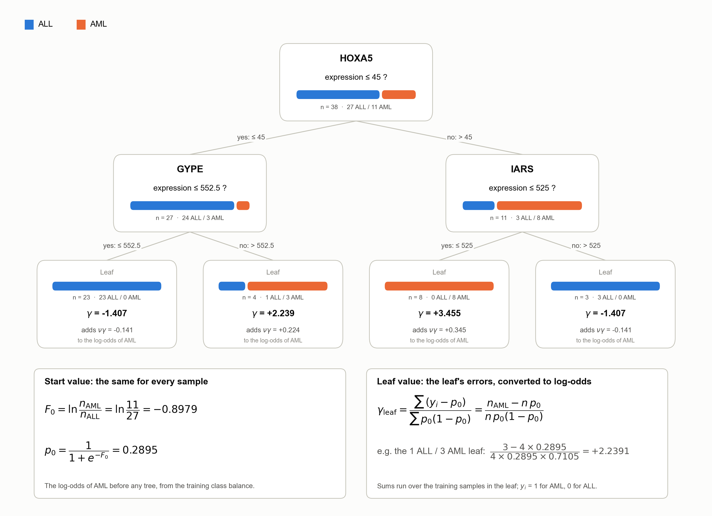
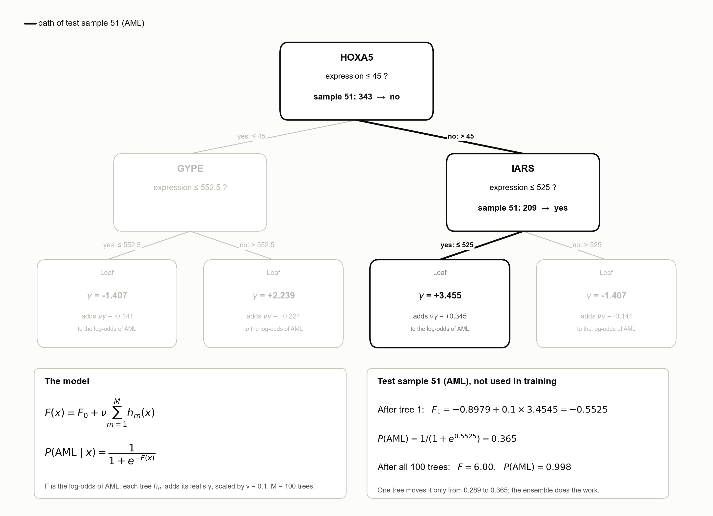

# gbt-demo

A demo of gradient boosted trees using the
[Golub et al. (1999)](https://doi.org/10.1126/science.286.5439.531) ALL/AML
leukemia gene-expression dataset (full reference under [Data](#data)).

## What is GBT?

Gradient boosted trees (GBT) make predictions by adding up results from many small decision
trees. The trees are built one at a time in training. Each new tree is fitted to the errors
that the trees before it make, and its output is scaled down by a learning
rate ν before it is added. No single tree is a good classifier on its own; the
sum is.

**Boosting** means combining many weak models, each contributng a partial finding, into one strong model. The name comes from the original question in
machine-learning theory: can a weak learner's accuracy be *boosted* to any level
you want? Schapire showed that it can[^schapire]. The solution is to train the
models in sequence and have each one focus on what the earlier ones got
wrong. **Gradient** says how "got wrong" is measured. Each tree is fitted to the
gradient of the loss, the direction that most reduces the error. For this
classifier that gradient is the residual $y - p$, so each tree learns
what is left over.

[^schapire]: Schapire RE, "The Strength of Weak Learnability", *Machine
    Learning* 5(2):197–227 (1990).
    doi:[10.1007/BF00116037](https://doi.org/10.1007/BF00116037).

### The biological problem

Here the task is binary: is a leukemia sample ALL or AML? Each sample is one
patient's expression profile, and each of the 7,071 probe sets is a feature. The
model works in log-odds of AML, F:

1. **Start** every sample at the log-odds of AML in the training set,
   $F_0 = \ln(11/27) = -0.898$, which is $P(\mathrm{AML}) = 0.29$.
2. **Fit a tree** to the residuals $y - p$, where $y$ is 1 for AML and 0 for
   ALL, and $p$ is each training sample's current predicted probability. Each
   leaf outputs one value,
   $\gamma = \sum (y - p) \big/ \sum p(1 - p)$, summed over the samples in that leaf.
3. **Add the tree**, scaled down: $F_m(x) = F_{m-1}(x) + \nu\,\gamma_m(x)$.
4. **Repeat** for M trees, then convert to a probability:
   $P(\mathrm{AML} \mid x) = 1 / (1 + e^{-F_M(x)})$.

The demo uses scikit-learn's
[`GradientBoostingClassifier`](https://scikit-learn.org/stable/modules/generated/sklearn.ensemble.GradientBoostingClassifier.html);
the scikit-learn user guide covers the method in
[Gradient boosting](https://scikit-learn.org/stable/modules/ensemble.html#gradient-boosting).
For larger datasets, scikit-learn's `HistGradientBoostingClassifier`,
[XGBoost](https://xgboost.readthedocs.io/) and
[LightGBM](https://lightgbm.readthedocs.io/) do the same thing much faster.

### Training: how the first tree is built



Tree 1 of 100, fitted to the 38 training samples (27 ALL, 11 AML). Each box
shows how the training samples divide at that split. Each leaf shows the value γ
the tree outputs for any sample that lands there, and the step νγ it adds to the
log-odds of AML.

### Prediction with one tree

Each internal node is a split prediction where a given value from the test sample is 
evaluated according to a simple formula for a gene and a gene-expression value
for that gene.



Test sample 51 (AML), which the model never saw in training, dropped through the
same tree. At each split the tree checks one gene, and the sample lands in a leaf
that adds 0.345 to its log-odds of AML. One tree only moves it from P = 0.29 to
P = 0.37.

### Prediction with the whole ensemble


The complete prediction runs the sample through all 100 trees and adds up their
outputs. Top: the sum written out, each tree drawn with the sample's path. Bottom:
every tree's step as a waterfall. 78 trees push sample 51 toward AML and 22
toward ALL; the total ends at F = 6.00, P(AML) = 0.998. The steps shrink as the
training samples become well fitted.

### Why many small trees instead of one big tree?

1. Big trees memorize: deep leaves hold one or two samples.
2. Big trees are unstable: small data changes give a different tree.
3. Many trees: each tree fixes the last one's mistakes.
4. Many trees: the learning rate stops any one tree dominating.
5. Many trees: graded scores, a smooth probability, not a few fixed answers.
6. Many trees: genes each add a little, like in biology.
7. Many trees: evidence is spread across genes, not one threshold.
8. Big tree: the top splits decide too much.

### Training and testing

`src/train_test.py` trains on the 38 training samples and tests on the 34
independent samples. For each test sample it prints P(AML) next to the paper's
own call, and it lists the genes the model relies on most. It has three models;
the random-genes model is the one drawn in the figures above.

| | Default model | Random-genes model (`--random-genes`) | Tuned model (`--tuned`) | The paper |
| --- | --- | --- | --- | --- |
| Settings | 100 trees, depth 2, ν = 0.1, every gene available at each split | the same, but a random 84 genes (`max_features="sqrt"`) at each split, `random_state=203` | keep the 50 genes with the best signal-to-noise, then 300 depth-1 trees, ν = 0.05, a random 7 genes at each split | 50 genes by signal-to-noise, each casting a weighted vote |
| Test errors | 3 / 34 (66, 67, 68) | 7 / 34, all AML called ALL | 2 / 34 in 12 of 20 seeds, 3 in 7, 4 in 1 | 2 / 34 if made to call every sample (66, 67) |
| Test log-loss | 0.94 | 0.56 | 0.29 (mean over seeds) | — |
| Test ROC AUC | 0.914 | 0.993 | 0.993 | — |
| Genes that affect the output | 1: Zyxin, in all 100 trees | 153 | 33 | 50 |

All three GBT models fit the 38 training samples correctly, so the test set is
what tells them apart. The paper only calls a sample when its prediction
strength is 0.3 or more: that way it called 29 of the 34 test samples, all of
them correctly, and left 5 uncertain (54, 57, 60, 66, 67).

- **The default model is not really boosting.** Its first tree splits on Zyxin
  (X95735_at), which alone separates all 38 training samples. Every later tree
  splits on Zyxin again and only makes the model more confident, so P(AML) ends
  up at 0 or 1, and the three mistakes are made with full confidence.
- **The random-genes model ranks the samples almost perfectly** (AUC 0.993) but
  puts the 0.5 cut-off in the wrong place for AML. Its settings were chosen so
  that tree 1 is readable, not for accuracy. Six of its seven errors are AML
  samples from St. Jude and CCG.
- **The tuned model matches the paper when both must call every sample.** Its
  settings were chosen by repeated 5-fold cross-validation on the training set
  only, from 96 combinations of tree depth, genes per split, row subsampling,
  learning rate and gene prefilter; the test set played no part. Four things
  helped: minimal trees, which make the model a sum of single-gene votes like the
  paper's; a random subset of genes at each split; the paper's 50-gene
  prefilter, refitted inside each cross-validation fold; and a smaller learning
  rate with more trees. Its result depends on the random seed, so the script
  runs 20 seeds and reports all of them. Six of its ten most important genes, Zyxin, CD33, the leptin receptor, E2A (TCF3), c-MYB and cyclin D3, are ones the paper names
  among its informative genes.

**Why no setting does better than the paper.** Every training AML sample came
from CALGB, and every training ALL sample from DFCI, so the training set
matches class with lab. The errors left in the tuned model are AML samples
from labs that sent no AML to the training set: 61 (St. Jude) and 66 (CCG) in
every seed, and 60 (St. Jude) in 40% of seeds. The model still ranks them
almost correctly, but its probabilities shift for samples from labs it has not
seen. The paper misses 66 too, but flags it as uncertain, and it calls 61
correctly; the GBT is confidently wrong on both. The GBT gets 67 right, which
the paper gets wrong.

### Running the code

```sh
uv run python src/train_test.py                 # train, test, compare with the paper
uv run python src/train_test.py --random-genes  # the same for the random-genes model
uv run python src/train_test.py --tuned         # the tuned model, over 20 seeds
uv run python src/fig_single_tree.py            # figures/tree_training.*, figures/tree_prediction.*
uv run python src/fig_ensemble.py               # figures/tree_ensemble.*
```

`uv run` creates `.venv/` and installs the dependencies on first use. Without uv,
in a virtual environment run
`pip install matplotlib numpy pandas "scikit-learn>=1.7,<1.8"`, then the same
scripts with `python`.

Each figure script writes a PNG, an SVG and a `.caption.md` with the full
caption. `src/golub.py` loads the data as sample × probe matrices, and the
paper's own predictions.

## Data

Golub TR et al., "Molecular Classification of Cancer: Class Discovery and Class
Prediction by Gene Expression Monitoring", *Science* 286:531–537 (1999).
doi:[10.1126/science.286.5439.531](https://doi.org/10.1126/science.286.5439.531).
The paper is © AAAS, so it is not included here; the Broad hosts a copy at
<https://pubs.broadinstitute.org/mpr/projects/Leukemia/Golub_et_al_1999.pdf>.

Downloaded 2026-11-16 from the Broad Institute's original publication page,
<https://pubs.broadinstitute.org/mpr/projects/Leukemia/>, into `data/raw/`.
The old `datasets.genepattern.org` copies (`all_aml_*.gct`) no longer resolve.

| File | Contents |
| --- | --- |
| `data_set_ALL_AML_train.txt` | Training set: 38 samples (27 ALL, 11 AML) × 7,129 probes |
| `data_set_ALL_AML_independent.txt` | Independent test set: 34 samples (20 ALL, 14 AML) × 7,129 probes |
| `table_ALL_AML_samples.txt` | Per-sample labels: ALL/AML, BM/PB, T/B-cell, FAB, source lab |
| `table_ALL_AML_predic.txt` | The paper's own predictions, for comparison |
| `table_ALL_AML_rfactors.txt` | Per-chip intensity re-scaling factors |
| `Files_descriptions.txt` | Broad's notes on the files |

### Format notes

- Platform: Affymetrix Hu6800 (HuGeneFL). Values are MAS4 "average difference"
  integers, so they include negative values (range about −28k to 71k).
- Each sample is a pair of columns: the expression value, then a `call` column
  (P/A/M, present/absent/marginal). Drop the `call` columns to get the matrix.
- Sample columns are **not** in numeric order (e.g. train runs 1–27, 34–38,
  28–33), so join to labels by sample number, not by position.
- Class labels are not in the expression files; take them from
  `table_ALL_AML_samples.txt` (samples 1–38 train, 39–72 test).
